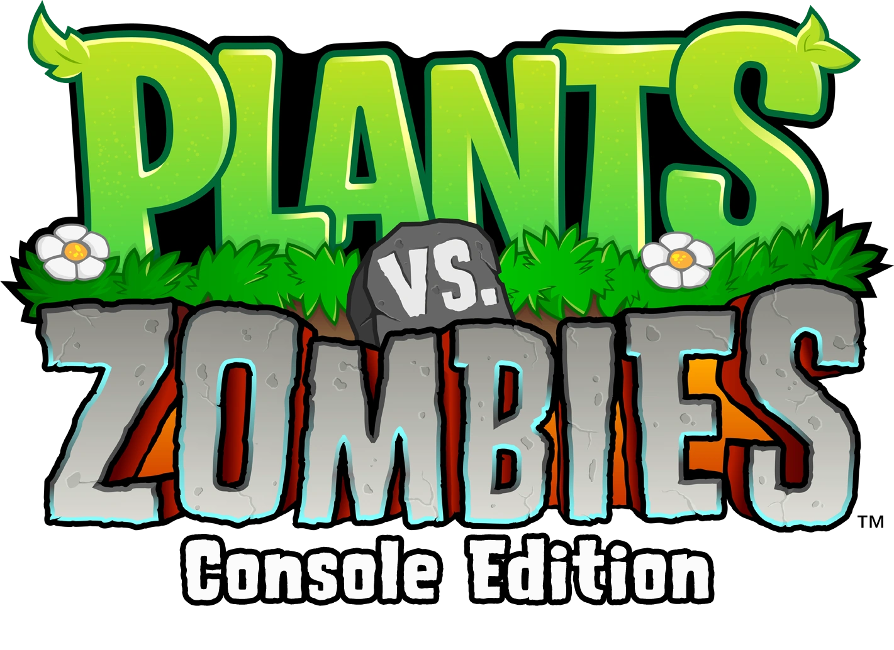
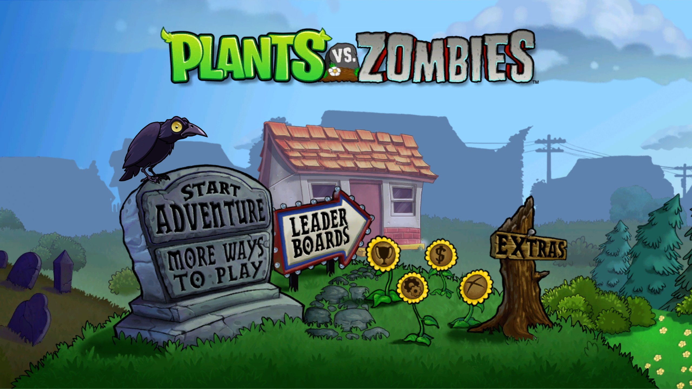
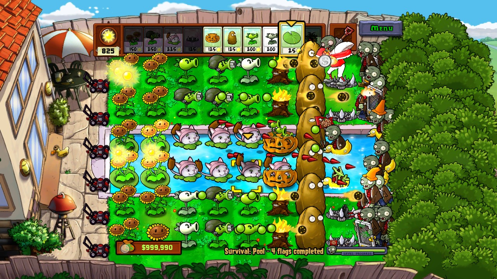
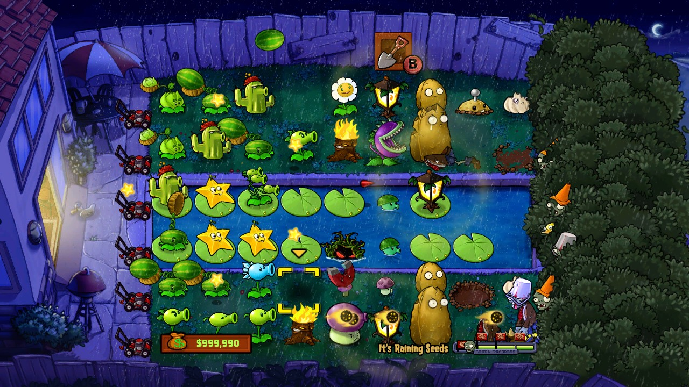
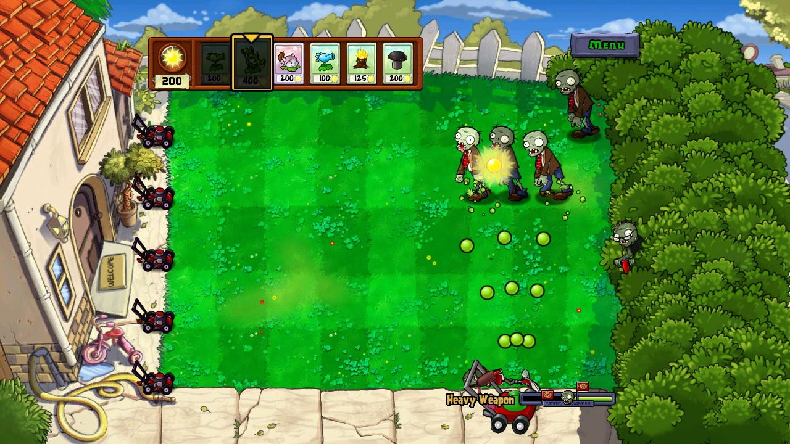

<p align="center">
  
</p>

<p align="center">
  <b>The Xbox 360 version of Plants vs. Zombies, running natively on Windows, with a mouse.</b><br>
  <a href="README.ru.md">Читать на русском</a>
</p>

---

The Xbox Live Arcade release of Plants vs. Zombies was the "deluxe" console edition:
local Versus, two-player Co-op, extra mini-games and a few things the PC version never
got. Its only drawback was that it lived on a console.

This project is a static recompilation of that release. The original PowerPC code was
translated to x86-64 with [ReXGlue](https://github.com/rexglue/rexglue-sdk) and runs as
a regular Windows program, without an emulator underneath. On top of it, the game learned
to work with a mouse: menus, the lawn, every mini-game and the multiplayer modes.

**No game files are included.** You need your own copy of the Xbox 360 game: the XBLA
package or a disc image. The program reads them on first launch.

> Version **0.7.0** is a beta. It is playable from start to finish, but rough edges remain.
> See [Known issues](#known-issues).

## Screenshots

<table>
  <tr>
    <td></td>
    <td></td>
  </tr>
  <tr>
    <td></td>
    <td></td>
  </tr>
</table>

## What you get

- **The whole console game.** Adventure, every mini-game, puzzle and survival mode, Zen
  Garden, Crazy Dave's shop, the Almanac, the Tree of Wisdom and Heavy Weapon. Nothing is cut.
- **Real mouse controls in two flavours:**
  - **PC mode** works the way the PC game does: click a seed packet, then a tile; click
    the sun to collect it.
  - **Console mode** keeps the Xbox logic: the cursor snaps to tiles and the wheel cycles
    seed packets.

  You can switch modes at any time in *Options → PC Settings*.
- **Local Versus and Co-op with a mouse and a gamepad.** One player takes the mouse, the
  other a controller. Menus belong to player 1's device, so nobody steals the pause menu.
- **Gamepads work as on the console,** and switching between the mouse and the gamepad
  happens on the fly. DualShock glyphs are supported (see below).
- **Bonus mini-games.** Finish every regular mini-game and a *Bonus Games* page opens with
  the hidden modes left in the game's data.
- **Smooth frame pacing.** With VSync the game follows your display up to 100 Hz.
  Frames are not doubled, so there is no judder on 75 Hz or 100 Hz monitors.
- **Easy setup.** On first launch, point it at your game package or a disc `.iso` and it
  imports and checks the files itself. A disc copy unlocks the full game right away.
- **Small PC touches.** A quit confirmation, achievements and cheat codes in a PC menu,
  `Escape` for pause, and a "Skip" button on the credits.

## Getting started

1. Download the latest archive from [Releases](../../releases) and unpack it anywhere.
2. Run `Start.bat`.
3. The **Game Files** window appears. Choose either:
   - the XBLA package from your Xbox storage (folder `584109FF\000D0000`), or
   - an Xbox 360 disc image (`.iso`) that contains the game.
4. The files are checked and copied once. With a package, you are then asked whether it is
   your purchased full version; trial and full version use the same package. A disc always
   means the full game.

Supported game build: TitleID `584109FF`, version `0.0.1.4`. Other builds are rejected,
because the recompiled code is tied to this exact executable.

### Controls

| | PC mode | Console mode |
|---|---|---|
| Left button | pick a seed / plant / collect | plant / collect |
| Right button | cancel what you hold | dig up (hold) |
| Wheel | — | cycle seed packets |
| Middle button | — | butter a zombie (Co-op) |
| `Escape` | pause | pause |
| `F12` | screenshot (PNG in `screenshots`) | screenshot |

Saves and settings live in `runtime-data\user`.

## Known issues

These are the problems we know about in 0.7.0:

- **No online features.** Leaderboards, Xbox LIVE mail and friends' houses need LIVE; the
  game explains this instead of failing. Survival Endless has no local leaderboard yet.
- **Zombiquarium:** thin dark lines flash around the *Menu* button for a frame or two on
  hover. This looks like a renderer edge case, not a game bug.
- **I, Zombie:** very fast repeated clicks can occasionally miss a placement.
- **Physical controllers** were tested less than the mouse. In particular, DualShock and
  DualSense glyphs and two real gamepads in one match need more testing.
- **DualShock glyphs** are drawn from the PS3 release's textures. The public archive does
  not ship them, so Xbox glyphs are shown unless you extract them yourself
  (`scripts/extract_ps3_controller_assets.py`).
- **PS3 dumps cannot be used to play.** The port needs the Xbox executable; see
  [docs/distribution.md](docs/distribution.md).
- **Some tester reports are still open:** a speed-up at 100 FPS that we could not
  reproduce, and occasional double steps in the pause menu with a gamepad.

Found something else? Open an issue and attach the newest file from the `logs` folder.

## Roadmap

The long-term goal is the ultimate console edition of Plants vs. Zombies: everything
the console releases offered, in one place, on the platforms you play on.

**Done**
- [x] Mouse controls for every screen and mode
- [x] Local Versus and Co-op with a mouse + gamepad
- [x] First-run import from an XBLA package or a disc image

**Next**
- [ ] Higher rendering resolutions and widescreen-friendly UI
- [ ] PC-style mouse art (cursor, tool icons) instead of console leftovers
- [ ] Local leaderboard for Survival Endless
- [ ] Wider controller testing (DualSense, Switch Pro, two pads at once)
- [ ] Fix the Zombiquarium hover artifact in the renderer
- [ ] Choose the game language (the other language packs are already in the game data)
- [ ] Rebindable keyboard shortcuts

**Later**
- [ ] Online play: Versus and Co-op over the network, leaderboards, mail
- [ ] Features from other console releases, such as Zombatar from the PS Vita version
- [ ] macOS and Linux builds
- [ ] Mobile (Android, iOS) and Nintendo Switch — under consideration, no promises
- [ ] Release 1.0

## Building from source

You need Windows x64, Visual Studio 2022+ with the C++ workload, Clang/LLVM, CMake,
Ninja and Python 3.10+. The game's code is generated from your own copy of the game, so
the repository cannot be built without it.

```powershell
.\setup.ps1 -Build -Package 'C:\path\to\584109FF\000D0000\<package>'
.\build.bat test
```

Technical notes, hook addresses and test reports are in [docs/](docs/). Start with
[docs/technical-notes.md](docs/technical-notes.md).

## Legal

This is an unofficial fan project. It is not affiliated with or endorsed by PopCap Games,
Electronic Arts or Microsoft. *Plants vs. Zombies* and its logo are trademarks of their
owners. The repository and the release archives contain no game data. To play, you need a
copy of the game you own.

The recompiler and runtime are [ReXGlue](https://github.com/rexglue/rexglue-sdk), which
builds on the [Xenia](https://xenia.jp) project. Their licenses are in
[third_party/](third_party/) and in the release archive.
